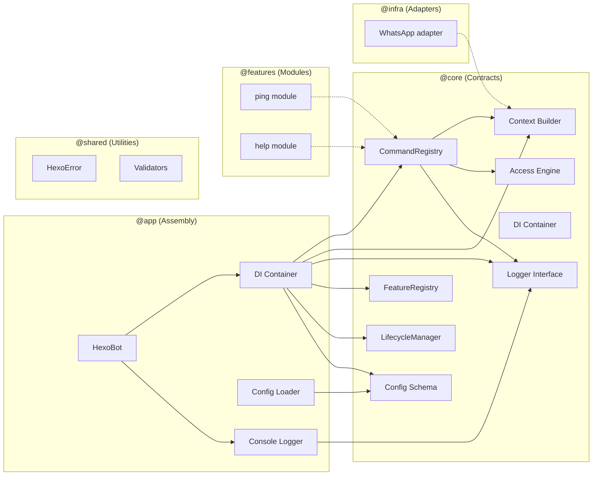

# HexoBot 3.0

Modular, multi-platform bot with structured commands and fully configurable architecture.

## Architecture



### Dependency Rules

| Module | May Import |
|--------|-----------|
| `@shared` | Nothing from the project |
| `@core` | `@shared` only |
| `@app` | `@core`, `@shared`, `@infra`, `@features` |
| `@features/*` | `@core`, `@shared` |
| `@infra/*` | `@core`, `@shared` |

**Never:** `@core` → `@infra` or `@features`. `@shared` → anything.

## Quick Start

### Prerequisites

- Node.js 22+
- npm 10+

### Installation

```bash
npm install
```

### Configuration

Edit `hexobot.config.yml`:

```yaml
bot:
  name: MyBot
  prefix: "!"
  agent: "mybot"
  adminJids: ["1234567890@s.whatsapp.net"]

logger:
  level: info
  format: text
```

Custom config path:

```bash
HEXOBOT_CONFIG_PATH=./my-config.yml npm start
```

### Dashboard

The backend can serve a dashboard API and, in production, the built frontend.
It listens on `127.0.0.1:3000` by default.

```bash
# Backend API (and built frontend when web/dist exists)
npm run dev

# Frontend dev server on http://localhost:5173 (proxies /api)
npm run web:install
npm run web:dev

# Production build
npm run build
npm run web:build
npm start

# Connect a WhatsApp account
# POST /api/platforms/whatsapp/connect  { "method": "qr" }
# POST /api/platforms/whatsapp/connect  { "method": "pairing-code", "phoneNumber": "5511999999999" }
```

Dashboard endpoints:

| Method | Path | Description |
|--------|------|-------------|
| GET | `/api/health` | Liveness and version |
| GET | `/api/platforms` | Platform summaries |
| GET | `/api/platforms/:platform` | Single platform summary |
| GET | `/api/logs?level=&limit=` | Newest logs, level and above |
| GET | `/api/messages?platform=&limit=` | Newest captured messages |
| POST | `/api/platforms/:platform/connect` | Start QR or pairing-code flow |
| POST | `/api/platforms/:platform/disconnect` | Close socket (`logout: true` clears session) |
| POST | `/api/platforms/:platform/send` | Send text with resolved mentions |
| GET | `/api/events` | SSE stream (`snapshot`, `connection`, `stats`, `log`, `message`, `ping`) |

When `web/dist` is absent, `GET /` returns a hint instead of failing.

### Development

```bash
# Watch mode (bot + API)
npm run dev

# Build
npm run build

# Start
npm start

# Frontend
npm run web:install
npm run web:dev
npm run web:build
```

### Testing

```bash
# Run all tests
npm test

# Coverage
npm run test:coverage

# Linting
npm run test:lint

# Type checking
npm run typecheck

# Architectural tests only
npm run test:arch
```

## Config Reference

### Bot

| Field | Type | Required | Default | Description |
|-------|------|----------|---------|-------------|
| `name` | string | yes | — | Bot display name |
| `prefix` | string | yes | — | Command prefix |
| `agent` | string | yes | — | Agent identifier |
| `adminJids` | string[] | no | `[]` | Admin JID list |

### Logger

| Field | Type | Required | Default | Description |
|-------|------|----------|---------|-------------|
| `level` | `debug\|info\|warn\|error\|fatal` | no | `info` | Log level |
| `format` | `json\|text` | no | `text` | Output format |

### Server

| Field | Type | Required | Default | Description |
|-------|------|----------|---------|-------------|
| `enabled` | boolean | no | `true` | Start the dashboard HTTP API |
| `host` | string | no | `127.0.0.1` | Bind address |
| `port` | number | no | `3000` | Bind port |
| `corsOrigins` | string[] | no | `["http://localhost:5173","http://127.0.0.1:5173"]` | Allowed origins |

### WhatsApp

| Field | Type | Required | Default | Description |
|-------|------|----------|---------|-------------|
| `enabled` | boolean | no | `true` | Mark platform as enabled |
| `sessionDir` | string | no | `./session` | Credentials and signal keys |
| `saveCreds` | boolean | no | `true` | Persist credentials on update |
| `autoReconnect` | boolean | no | `true` | Reconnect after drops |
| `maxReconnectAttempts` | number | no | `5` | Reconnect limit |
| `reconnectDelayMs` | number | no | `5000` | Delay between attempts |
| `printQRInTerminal` | boolean | no | `false` | Print QR to terminal |

### Features

Each feature can have `enabled` (boolean) and `config` (object):

```yaml
features:
  ping:
    enabled: true
    config:
      timeout: 5000
```

## Project Structure

```
src/
  core/              # Core contracts (no platform deps)
    config/          # Config schemas & types
    commands/        # Command definitions & registry
    context/         # Universal context types & builder
    logger/          # Logger interface
    access/          # Access levels & engine
    di/              # Dependency injection container
    features/        # Feature registry
    lifecycle/       # Lifecycle stages & manager
  shared/            # Shared utilities
  app/               # Application assembly
    api/             # Fastify REST + SSE endpoints
    monitor/         # Logs, stats, messages, connection state
  infra/             # Platform adapters
  features/          # Feature modules
  tests/             # Tests
```

## Modules

- `@core/config` — Config schemas, types, and validation
- `@core/commands` — Command definitions, registry, and dispatch
- `@core/context` — Universal context and builder
- `@core/logger` — Logger interface and log levels
- `@core/access` — Access levels and permission engine
- `@core/di` — Dependency injection container
- `@core/features` — Feature registry and definitions
- `@core/lifecycle` — Lifecycle stages and manager
- `@shared/errors` — Base error class
- `@shared/validation` — Common validators
- `@app` — Bot assembly and entry point
- `@app/api` — Fastify REST + SSE dashboard API
- `@app/monitor` — Bounded logs, platform stats, and connection state
- `@infra/whatsapp` — Baileys adapter, session, identity, and mention normalization
